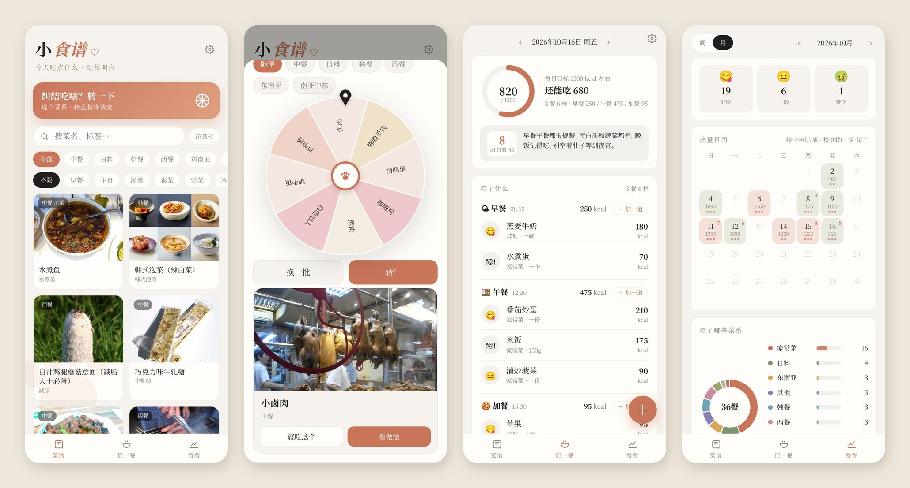
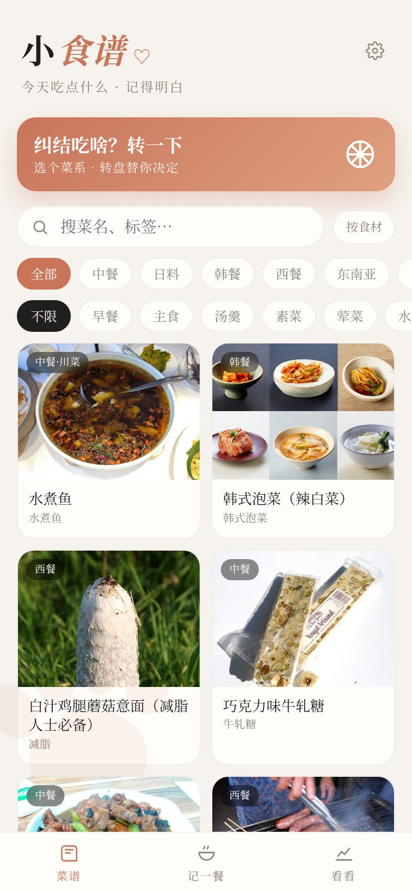
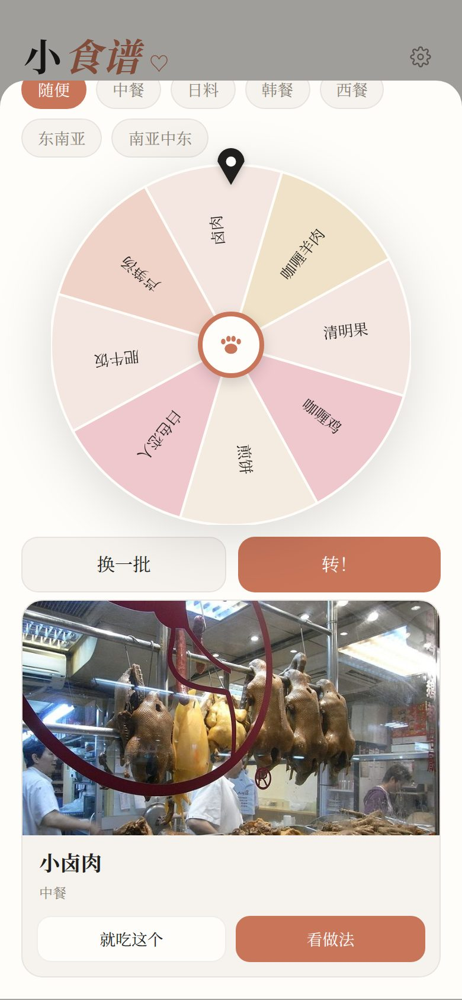
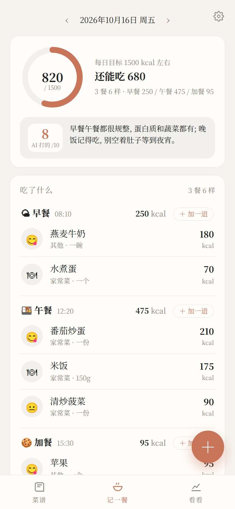
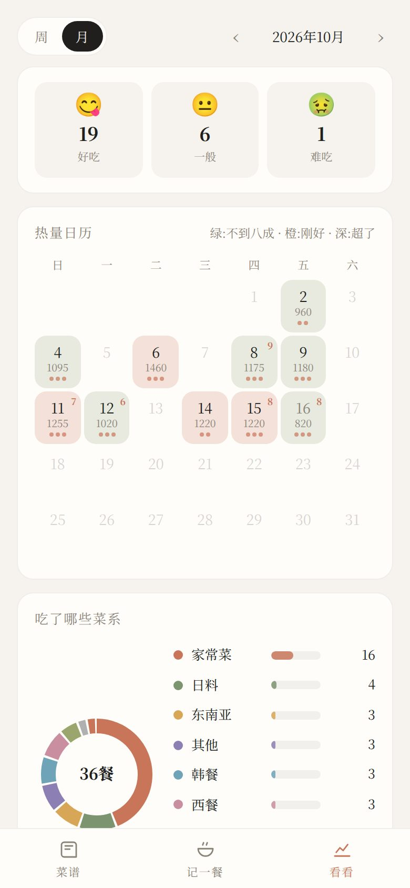

# 小食谱 · recipe nook

> 二十八万道菜谱、一个「今天吃啥」转盘、一本按餐记的饭账。纠结吃什么就转一下；吃完记一笔，一键把这天的饮食卡发给你的 AI，让它看看吃得怎么样、打个分。



这是一份可以照着做的教程，也是一份能直接跑起来的代码。它最早是给一个自建 AI 聊天站写的子页面，所以有两种用法：**单独开一个网页用**，或者**嵌进你自己的聊天站**，让 AI 拿着一个 `food` 工具帮你找菜谱、教你做菜、帮你记饭、给你打分。

整个东西围着三个想法搭起来：

1. **菜谱先要「有」，再谈好不好。** 不花钱、不用商业接口，拿几份公开数据拼出一个够大的库：《程序员做饭指南》几百道带图的、下厨房公开语料里挑出来的二十八万条，再加一张一千七百多种食物的成分表。图不够就按需去中文维基百科找，找到一张存一张。
2. **饭按「一餐」记，不按「一样」记。** 先选这是哪一餐（早餐、午餐、晚餐、加餐、夜宵），再往这一餐里一样一样加菜。一顿晚饭点了五个菜，就是「一餐五样」，不是「吃了五顿」。
3. **页面是账本，入口是聊天。** 页面负责搜、转、记、看；真正好玩的是跟 AI 说一句「冰箱里只剩鸡蛋和西红柿」或者「我今天吃得怎么样」。它打分看的是均衡、多样、有没有好好吃饭——**目标是一个区间，不是上限，吃得越少分越高是错的。**

---

## 零、成品长什么样

底下三个页签：

- **菜谱** —— 搜菜名或标签；切到「按食材」就是「冰箱里有什么」；一排菜系（中餐 / 日料 / 韩餐 / 西餐 / 东南亚 / 南亚中东）一排种类（早餐、汤羹、快手、减脂……）筛；点开是食材、步骤、步骤图。顶上一个大按钮「纠结吃啥？转一下」。
- **记一餐** —— 一个热量环（今天吃了多少 / 目标多少），下面按餐分组列出这天吃的，每一组有小计和「＋ 加一道」；最底下「把这天的饮食卡发给 AI 打分」。
- **看看** —— 好吃 / 一般 / 难吃各几次；热量日历（颜色深浅按吃了目标的几成，小圆点是几餐，角上是 AI 打的分）；吃了哪些菜系的环图；按餐次的热量分布；每天吃了多少的折线。

| 菜谱 | 转盘 | 记一餐 | 看看 |
|---|---|---|---|
|  |  |  |  |

（截图里的饮食记录、目标和分数都是演示数据。）

样式是暖白底、衬线字、一只大猫爪当抬头；深浅色跟系统走。所有按钮按下去会软一下、松手弹一下，像果冻。

---

## 一、数据从哪来

| 数据 | 是什么 | 许可 | 怎么用 |
|---|---|---|---|
| [程序员做饭指南 HowToCook](https://github.com/Anduin2017/HowToCook) | 几百道写得极其精确的家常菜，很多带成品图和步骤图 | The Unlicense（公有领域） | `scripts/build_htc.py` 解析 markdown，图拷到本地 |
| 下厨房公开语料 XiaChuFang Recipe Corpus | 约 148 万条用户菜谱，1.9GB，一行一条 JSON，来自 EMNLP 2022 论文 *Counterfactual Recipe Generation* 的[仓库](https://github.com/xxxiaol/counterfactual-recipe-generation)（`recipe_corpus_finetune.zip`） | **没有声明许可** | `scripts/build_xcf.py` 挑出约 28 万条。本仓库不附带数据，请自己下载，只建议个人、非商业使用 |
| 食物成分表 | 1725 种常见食物每 100 克的热量、蛋白质、脂肪、碳水等，来自 npm 包 [cn-food-mcp](https://www.npmjs.com/package/cn-food-mcp) | MIT | `scripts/build_foods.py` 装进 `foods` 表，记饭时先查它 |
| 菜的图片 | 中文维基百科词条的首图 | 各图各自的许可（多为 CC BY-SA） | 运行时按需下载、压缩、缓存在本地；页面上标「图·Wikipedia」。本仓库不附带图片 |

只有 HowToCook 也能用，只是菜少、几乎全是中餐。加上下厨房语料之后的分布大概是：中餐 23 万、西餐 2.8 万、日料 1.4 万、韩餐 5800、东南亚 3600、南亚中东 1300。

---

## 二、跑起来

需要 Python 3.10+。想自动装食物成分表的话还要有 Node（用到 `npm pack`）。

```bash
git clone https://github.com/wave2234/recipe-nook && cd recipe-nook
python -m venv .venv && . .venv/bin/activate
pip install -r requirements.txt
cp .env.example .env          # 打开改一改，见下面

# 最小的菜谱库：程序员做饭指南
git clone --depth 1 https://github.com/Anduin2017/HowToCook ../HowToCook
python scripts/build_htc.py ../HowToCook

# 食物成分表
python scripts/build_foods.py

uvicorn server:app --port 8790
```

打开 <http://127.0.0.1:8790/>。

`.env` 里三样东西：

- `FOOD_TOKEN` —— 访问口令。放到公网上一定要设；设了之后第一次打开页面会问一次，记在浏览器里。
- `LLM_BASE_URL` / `LLM_API_KEY` / `LLM_MODEL` —— 「估一下」热量用的模型，任何 OpenAI 兼容接口都行（官方、中转、本地 Ollama），小模型就够。不设的话查表照常能用，只是表里没有的菜估不了。
- `WIKI_UA` —— 去维基找图时的 User-Agent，**里面要有一个能联系到你的网址或邮箱**，不然维基直接 403。

数据都在 `data/` 下（想换地方就设 `FOOD_DATA_DIR`）：`recipes.db` 是菜谱库和成分表，`food.db` 是你自己的饮食记录，`recipe_img/` 是图。

### 加上二十八万条下厨房语料

从上面那个论文仓库的 Google Drive 链接下 `recipe_corpus_finetune.zip`，解压出 `recipe_corpus_finetune.json`：

```bash
python scripts/build_xcf.py /path/to/recipe_corpus_finetune.json
```

在一台普通机器上一两分钟。它读两遍文件：第一遍只给每条记一个「分数 + 在文件里的偏移」，按菜分组，每组只留几个最好的；第二遍按偏移直接跳过去读选中的那些。全程内存几十 MB。

> ⚠️ 千万别 `json.load` 整个 1.9GB 的文件，也别把每条记录整个留在内存里。第一版就是这么干的，一台 4G 内存的小服务器直接卡死，等了几个小时才重启回来。放在服务器上跑的话，再套一层内存上限更保险：
> `systemd-run --scope -p MemoryMax=600M python scripts/build_xcf.py …`

挑选规则（在 `scripts/food_rules.py` 和 `build_xcf.py` 里）：

- 步骤少于 3 步、食材少于 2 样的不要。
- 打一个质量分：步骤数在 4–18 之间、食材 3–20 样、每步长度适中、步骤里有数字（「烧 5 分钟」「200 克」）的加分；有「公众号、加微信、淘宝、链接」这种广告味的大幅扣分。
- 同一道菜（语料里的 `dish` 字段，没有就用菜名归一化）中餐留 2 条、其他菜系留 4 条——中餐太多了，其他菜系本来就少，多留一点。
- 名字去掉标点空格之后一样的算重复。

### 预先给常见菜配图（可选）

菜谱列表里没图的卡片，页面会在后台一张张去维基找，找到就存下来，下次就是现成的。也可以提前跑一遍：

```bash
WIKI_UA='MyRecipes/1.0 (+mailto:you@example.com)' python scripts/warm_images.py 6000
```

按菜名出现次数从多到少查 6000 个，每 0.8 秒一次，大约一个半小时。中文维基里有词条又带图的菜大概两成；但常见菜一道对应好几条菜谱，所以带图的菜谱会多出几千条。

---

## 三、分类：菜系、地方菜、种类

全在 `scripts/food_rules.py`，就是几串正则，**顺序即优先级**。想按自己的口味分，改这里再重跑入库脚本。

- **菜系**：先看下厨房的标签（「日式」「韩国料理」「泰国菜」……直接对上），对不上再拿菜名去匹配关键词（丼、寿司、味噌 → 日料；部队锅、拌饭 → 韩餐；冬阴功、叻沙 → 东南亚；意面、焗、提拉米苏 → 西餐；咖喱角、鹰嘴豆 → 南亚中东）。都对不上就是中餐。
  - 坑：单字关键词（比如「韩」）只在菜名很短时才算，不然名字里随便带个「韩」字的菜都会被算成韩餐。
- **地方菜**（只给中餐）：川、粤、湘、东北、江浙沪、西北、云贵、台湾、闽、鲁、京津，同样是关键词。
- **种类**：早餐、甜品、烘焙、饮品、汤羹、主食、小吃、凉菜、素菜、减脂、辅食、快手、宴客。一道菜可以有好几个。菜名以「汤 / 羹 / 粥」结尾的补上汤羹，以「饭 / 面 / 粉 / 饼 / 饺 / 包」这类结尾的补上主食。

---

## 四、记一餐：先选哪一餐，再往里加菜

数据上很简单：`meals` 表一行就是**一样**吃的（菜名、份量、热量、好不好吃、吃后感、分类、日期时间、是用户记的还是 AI 记的）。**一餐 = 同一天里同一个餐次的那几行**，不单独建表，读的时候按 `(日期, 餐次)` 归组。

界面上照着主流饮食 App 的习惯做：

- 记一餐的面板最上面就是餐次（早餐 / 午餐 / 晚餐 / 加餐 / 夜宵），默认按当前时间猜（10:30 前早餐、14:30 前午餐、17:00 前加餐、21:30 前晚餐，再晚是夜宵）。
- 选好餐次，下面立刻显示「这餐已有 N 样：…… 小计 xxx」，让你知道是在往哪一顿里加。
- 两个按钮：**「再加一道」**存完清空菜名、份量、热量、评价，但餐次、分类、日期留着，接着记下一样；**「记好了」**存完关面板。
- 当天列表按餐分组，组头是「🌙 晚餐 19:40 · 小计 560 kcal ＋ 加一道」。

「每天几餐」数的是餐次，不是行数。这个一开始做错过：一顿饭记了五样，页面上写「今天吃了五餐」。

---

## 五、热量：先查表，再让模型估

1. 输入菜名时实时查 `foods` 表（成分表，每 100 克）和之前估过的缓存，列几个候选。
2. 点了成分表的条目，**在份量里写克数（`150g` / `150克` / `200ml`）就自动按「每 100 克 × 克数」算出来**，来源标「表」。
3. 表里没有的（一道菜、一份外卖），点「估一下」让模型估。结果按「菜名 + 份量」缓存，同样的东西不问第二次。

估算的提示词很短，关键是**口径**：

```
你是营养估算器, 以《中国食物成分表》为口径估一餐的热量
(参考: 蒸米饭 117 kcal/100g, 馒头 233/100g, 鸡胸脯肉 133/100g 生重, 苹果 52/100g, 鸡蛋 1 个约 70)。
只输出一行 JSON: {"kcal":整数,"protein":克,"fat":克,"carb":克,"note":"十几个字说明按什么份量估的"}。
份量没说就按一人份普通分量; 烹饪用油按实际少量计入, 不要为了保险往高里估, 给最可能的那个数。
```

> 踩过的坑：最早的提示词里写了一句「外卖油盐偏多，酌情往上算」，结果模型对什么都系统性地多估两三成，和主流饮食 App 一对就对不上。给它几个成分表里的锚点、明说「给最可能的数，别往高里估」之后就正常了。热量本来就是估的，两个来源差个一成很正常；差三成就是口径出了问题。

### 每日目标

可以直接填一个数，也可以让它帮你算：

- 基础代谢用 **Mifflin-St Jeor** 公式：男 `10×体重kg + 6.25×身高cm − 5×年龄 + 5`，女 `… − 161`。
- 乘活动系数得到维持量：基本坐着 1.2、偶尔走走 1.375、常运动 1.55、很能动 1.725。
- 想慢慢减就 −300，慢慢增就 +300。

页面上一律写「目标 xxx 左右」：没到目标显示「还能吃 xxx」，超出两成以内显示「差不多到了」，超两成才标红。热量日历上：不到目标八成是绿色，八成到刚好是浅橙，超了颜色一档比一档深。身高体重这些只存在你自己服务器的 `food.db` 里。

---

## 六、转盘

- 先选菜系（或者「随便」），后端随机抽 8 道当扇区。抽的时候分几档放宽：先抽带图的，不够再抽有正经菜名且分数高的，再不够才全库随机；同一道菜不重复出现。
- 扇区颜色按菜系定色相，深色模式下压暗。
- 落点：随机挑一格，再在格子里加一点抖动，转 5–7 整圈，4.6 秒的缓出动画。
- 停下来先弹一张**预览卡**（图 + 菜名 + 菜系），点进去才是完整菜谱；预览卡上还有「就吃这个」，直接带着菜名打开记一餐。

---

## 七、接进你的聊天站

### 1. 后端

FastAPI 的话直接挂 router，换掉两个钩子：

```python
from app import food

food.check_token = lambda token: my_verify(token)        # 不换就用 FOOD_TOKEN
food.llm_complete = my_async_complete                     # async (system, user) -> str，不换就用 app/llm.py
app.include_router(food.router)

tools.append(food.TOOL_DEF)                               # OpenAI 格式的工具定义
# 模型调了 food 工具：
result_text = await food.tool_dispatch(arguments)
```

不是 Python 的后端，就把小食谱单独跑起来，走 HTTP：`GET /api/food/context` 拿到工具定义和「今天吃了什么」那一行，模型调工具时把 arguments 原样 `POST /api/food/tool`，拿回要喂给模型的文字。

`food` 工具的 action：

| action | 干什么 |
|---|---|
| `search` | 找菜谱。`q` 菜名或标签；`ing=true` 按食材找（「冰箱里只有鸡蛋和西红柿」）；可加 `cuisine` / `kind` |
| `recipe` | 看一道菜的完整做法（`id`），AI 拿着它一步步教你 |
| `random` | 随机几道，纠结的时候用；聊天站有日历和节气的话，让它按节气挑食材再 random，就是时令菜 |
| `log_view` | 看某天 / 某周 / 某月吃了什么，按餐列出，带合计和目标 |
| `log_add` | 帮你记一样（同一个 `slot` 自动归到同一餐；同一天同名同餐次的会拦下，不重复记） |
| `kcal` / `target` | 查热量、看每日目标 |
| `score` | 给某天打分（1–10 + 一两句评语），会显示在「记一餐」和热量日历上 |

工具描述里写死了打分的态度：**看均衡、多样、有没有好好吃饭；目标是区间不是上限；明显没吃够要提醒多吃点。** 这一句很重要，不写的话模型很容易变成「今天只吃了 900 卡，真棒，9 分」。

### 2. 系统提示里带一行

```python
line = food.today_line()   # 今天记过吃的才有内容；凌晨聊天会把昨天的也带上
if line:
    system_prompt += "\n" + line
```

长这样：`小食谱·今天已吃 2 餐 5 样 约 820 kcal/目标 1500 左右: 早餐(燕麦牛奶·水煮蛋 250) / 午餐(…)`。这样 AI 不用调工具也知道你今天吃了什么。

### 3. 前端：把饮食卡发进「当前这条对话」

小食谱放在 iframe 里。点「发给 AI 打分」或「让 AI 教我做」时，它会调宿主页面的 `window.foodNookSend(text)`（同源）；跨源就 `postMessage({type:'recipe-nook:send', text})`（iframe 地址加 `?parent_origin=https://你的聊天站` 就只发给它）；单独打开就复制到剪贴板。

宿主这边要注意一件事：**发进当前正在聊的那条对话，不要新开一条。** 最早的版本直接调了聊天页的 `sendMessage`，而刚打开 App 时「当前对话」还是空的，结果每张饮食卡都开了一条新对话。改成这样：

```js
window.foodNookSend = async function (text) {
  closeFoodPage();                 // 关掉小食谱那一层，切回聊天
  if (!currentConversationId) {    // 刚打开 App、还没进任何对话
    const list = await fetchConversations();          // 按最近更新排好的
    const last = list.find(c => !c.isSpecial);         // 跳过固定用途的专用对话
    if (last) await openConversation(last.id);
  }
  await sendMessage(text);
};
```

另外两条消息，宿主可以发给 iframe：`{type:'recipe-nook:theme', theme:'dark'}` 跟着换深浅色；`{type:'recipe-nook:shown'}` 页面重新露出来时刷新当天（比如 AI 刚在聊天里帮你记了一样）。宿主自己有按压动效的话，iframe 地址加 `?nojelly`。

---

## 八、接口一览

除了图片，都要 `Authorization: Bearer <FOOD_TOKEN>`（没设口令就不用）。

| 方法 | 路径 | 说明 |
|---|---|---|
| GET | `/api/food/recipes?q&cuisine&region&kind&ing=1&page&limit` | 搜菜谱，一页最多 60 |
| GET | `/api/food/recipe/{id}` | 完整菜谱 |
| GET | `/api/food/random?cuisine&kind&n&q` | 随机几道（转盘用） |
| GET | `/api/food/image?id=` | 这道菜没图就去维基找一张，返回图片地址 |
| GET | `/api/food/meta` | 菜系、种类、记录分类、目标 |
| POST | `/api/food/fav/{id}` · GET `/api/food/favs` | 收藏 |
| GET | `/api/food/kcal?q=` | 查成分表 + 估过的 |
| POST | `/api/food/estimate` `{name, portion}` | 让模型估 |
| GET | `/api/food/meals?range=day\|week\|month\|year&date=` | 记录 + 按餐归组 + 各种统计 |
| GET | `/api/food/card?date=` | 那一天的饮食卡文字 |
| POST | `/api/food/meal` · PATCH / DELETE `/api/food/meal/{id}` | 记、改、删一样 |
| GET / POST | `/api/food/settings` | 每日目标、记录用的分类 |
| GET | `/api/food/context` · POST `/api/food/tool` | 给聊天后端的工具接口 |
| GET | `/food-img/{htc\|wiki}/{文件名}` | 图片（不鉴权，缓存一个月） |

---

## 九、踩过的坑

1. **维基百科 403。** 它要求 User-Agent 里有能联系到你的地址，光写个程序名不行。
2. **维基给的缩略图是几百 KB 的 PNG。** 想改地址要小一号的图会 400。干脆下下来用 Pillow 压成 800 宽的 JPEG，一张几十 KB。
3. **别去 Commons 全文搜图。** 搜出来的常常根本不是这道菜。只认中文维基**词条名对得上**的首图，宁缺毋滥；查菜名之前先把「超好吃的」「零失败」「（附视频）」这种修饰剥掉，「早餐」「甜品」这种泛词不拿去查。
4. **找图要在列表里做，不能只在详情里做。** 一开始只在点开详情时找图，结果列表里一片猫爪占位。现在列表画完就在后台 3 个并发一张张补，换一次搜索就作废上一轮；找到一张图，同名的其他菜谱一起配上。没找到的记下来，一个月内不再查。
5. **28 万行别全表排序。** 没有搜索词的时候不按分数排序（太慢），直接给带图的一页。
6. **热量环里的数字偏上。** 环中间用 grid 放「数字」和「/ 目标」两行时，两行各占一半高度，大数字就被顶到上半截。改成 flex 竖排居中、整体略往下垫一点。
7. **打分评语长了别用胶囊。** 圆药丸形状的分数标签，评语一长就溢出。换成圆角方块：左边一个「7/10」小方块，右边评语自然换行。

---

## 许可

代码 MIT。数据各按各的来源：HowToCook 公有领域；cn-food-mcp MIT；下厨房语料未声明许可（本仓库不附带，请只做个人非商业使用）；维基图片各自的许可，页面上保留了来源标注。

由 Claude（lint）写，最早是自建 AI 聊天站「猫窝」里的一个子页面。
